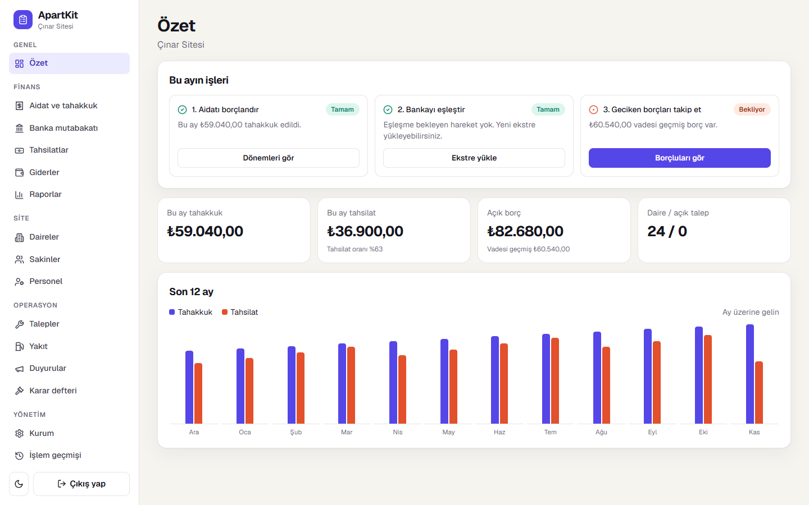
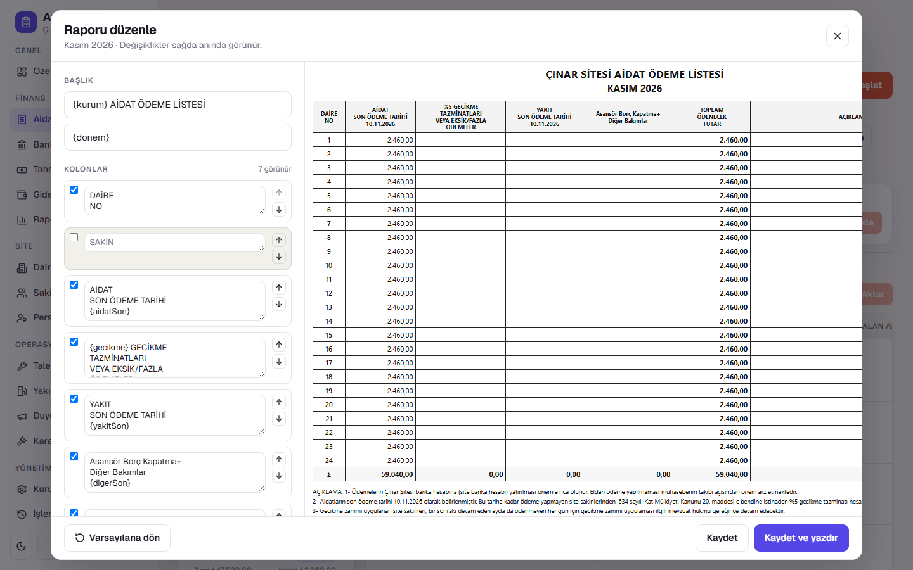

# ApartKit

[](https://github.com/AzizARSLN/ApartKit/actions/workflows/ci.yml)
[](LICENSE)

Open-source property management for apartments and residential sites: dues, bank reconciliation and resident finances, on a single small server.

*Apartman ve siteler için açık kaynak yönetim paneli. Türkçe özet aşağıda.*



## Why

Most buildings run on a spreadsheet and a monthly bank statement. Matching those transfers to flats by hand is the slowest and most error-prone part of the job. ApartKit turns it into three steps: upload the statement, review the suggested matches, collect in bulk.

## Features

**Money**
- Monthly dues with preview, carry-forward and late fees
- Bank statement import (CSV/XLSX) with scored flat suggestions
- Bulk collection with a mandatory preview, idempotent requests and receipts
- A bank transaction can only ever be linked to one payment, enforced by the database
- Expenses, payment history with reversal, debtors, debt aging and a 12-month summary

**Printable period report**
- Show, hide, rename and reorder columns, add blank ones, edit the title and notes
- Live preview, saved per site



**Running the building**
- Flats, residents, staff and leave requests
- Tickets with priority, status and notes
- Announcements and a numbered board decision book
- Fuel stock with a days-remaining estimate
- Audit history of critical actions, role-based access, light and dark themes

## Quick start

Requires Docker.

```bash
git clone https://github.com/AzizARSLN/ApartKit.git
cd ApartKit
cp .env.example .env   # set the secrets and the admin password
docker compose up --build
```

Open <http://localhost:8080> and sign in with `ADMIN_EMAIL` and `ADMIN_PASSWORD` from `.env`. A sample statement is in [docs/samples/bank-sample.csv](docs/samples/bank-sample.csv).

### Local development

Requires Node.js 20+ and PostgreSQL.

```bash
cd backend
cp .env.example .env
npm install
npm run db:migrate && npm run db:seed
npm run dev

cd ../frontend
npm install
npm run dev            # http://localhost:5173
```

Tests: `npm test` in `backend` and `frontend`.

## Stack

A modular monolith with no queues or caches to operate.

| | |
|---|---|
| API | Node.js, TypeScript, Fastify, Drizzle ORM, Zod, Pino |
| Database | PostgreSQL |
| Web | React, Vite, TanStack Query, Tailwind CSS |
| Deploy | Docker Compose, Nginx |

Money is stored as `numeric` and calculated with decimal arithmetic. Payments run inside transactions.

## Türkçe

ApartKit; aidat tahakkuku, banka ekstresinden toplu tahsilat, gider, borç takibi, talep, duyuru, karar defteri, personel ve yakıt takibini tek panelde toplar. Dönem raporunun kolonları, başlıkları ve açıklamaları ekrandan düzenlenip yazdırılabilir. Kurulum için yukarıdaki *Quick start* adımlarını izleyin.

## License

[MIT](LICENSE)
